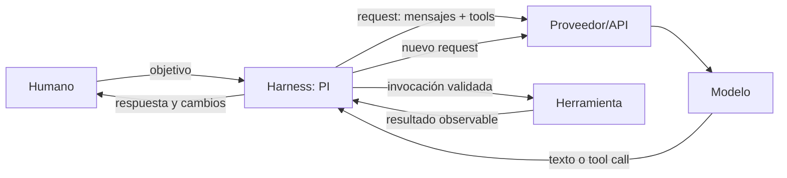
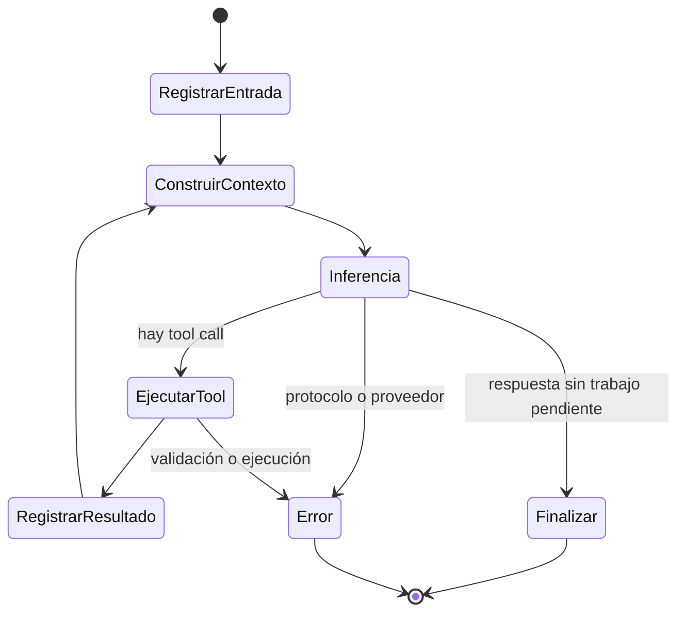

# 1. Harness y bucle agente

## La separación que organiza todo lo demás

Un **modelo** recibe una secuencia de entrada y genera una secuencia de salida. Aunque
su salida pueda describir una orden como «ejecuta `git status`», el modelo no posee
por sí mismo un terminal, un sistema de archivos ni permisos Unix.

Un **harness agente** es el programa anfitrión que conecta esa capacidad generativa
con estado, herramientas y un entorno real. PI es ese programa. El proveedor aloja o
sirve el modelo; el harness decide qué enviarle, interpreta su respuesta y ejecuta las
acciones autorizadas.



Esta distinción evita cuatro errores comunes:

- El modelo **no ejecuta** una tool: genera una solicitud estructurada; el harness la ejecuta.
- La API **no es** el modelo: es una frontera de acceso ofrecida por un proveedor.
- El contexto **no es** todo lo almacenado: es lo seleccionado para una inferencia concreta.
- Una respuesta convincente **no demuestra** que el efecto externo haya ocurrido.

## Un agente no es una sustancia distinta

En este curso llamaremos agente al sistema completo mientras está persiguiendo un
objetivo mediante varias transiciones. No necesitamos suponer que el LLM contiene un
«modo agente» especial. La conducta emerge de combinar:

- un modelo capaz de escoger el siguiente paso;
- instrucciones y observaciones dentro de su contexto;
- herramientas descritas mediante contratos;
- un bucle que vuelve a consultar al modelo después de cada resultado;
- estado persistente y reglas de parada;
- autoridad real concedida al proceso.

Una forma compacta de representarlo es:

```text
estado_(n+1) = transición(estado_n, salida_modelo, resultado_herramienta)
```

El modelo participa en la decisión, pero la función de transición pertenece al
harness. Por eso cambiar el harness manteniendo el mismo modelo puede alterar mucho
el comportamiento observado.

## El bucle mínimo

Supongamos que pedimos «averigua la versión del proyecto». El recorrido conceptual es:

1. PI registra el mensaje del usuario.
2. Construye una petición con instrucciones, historial relevante, tools disponibles y
   ajustes del modelo.
3. El proveedor transmite la salida del modelo.
4. El modelo puede responder directamente o emitir una llamada, por ejemplo
   `read({"path":"package.json"})`.
5. PI valida y despacha esa llamada a la implementación de `read`.
6. PI registra el resultado como un mensaje correlacionado con la llamada.
7. Como hay una observación nueva, vuelve a consultar al modelo.
8. El modelo produce la respuesta final y el run termina si no quedan llamadas ni
   mensajes encolados.



En PI, una **turn** se completa al registrar una respuesta del asistente, ejecutar sus
tool calls y registrar sus resultados. Un **run** puede contener varias turns. Esta
diferencia será importante al estudiar mensajes encolados, eventos y cancelación.

## Qué contiene una petición al modelo

Todavía sin entrar en la sintaxis HTTP/JSON, el paquete lógico incluye:

```text
request al modelo
├── identidad y parámetros del modelo
├── system prompt
│   ├── instrucciones base de PI
│   ├── context files descubiertos
│   └── instrucciones añadidas por extensiones
├── mensajes de la rama activa
├── definiciones de herramientas disponibles
├── descripciones de skills disponibles
└── parámetros de generación y razonamiento
```

No todos los proveedores representan exactamente igual estas piezas. Una tarea del
harness o de su capa de proveedor consiste en traducir la representación interna al
protocolo que admita cada servicio y normalizar después la respuesta.

## Tool calling: propuesta frente a efecto

Una definición de tool suele declarar un nombre, una descripción y un esquema para
los argumentos. Eso orienta al modelo y permite validar una llamada. La implementación
es código normal que corre en algún lugar concreto.

```text
Modelo                          Harness                         Sistema operativo
  |                                |                                  |
  | tool_call: bash({command})     |                                  |
  |------------------------------->|                                  |
  |                                | validar política y argumentos     |
  |                                | ejecutar proceso ---------------->|
  |                                |<---------------- exit/stdout/stderr|
  | tool_result(call_id, resultado)|                                  |
  |<-------------------------------|                                  |
```

El identificador de la llamada permite emparejar propuesta y resultado. Este detalle
parece administrativo, pero es esencial cuando existen varias llamadas, streaming,
reintentos o ejecución paralela.

## Estado en tres planos

Conviene separar tres clases de estado:

| Plano | Ejemplos | Quién lo conserva |
|---|---|---|
| Conversacional | mensajes, tool calls, resúmenes | sesión/harness |
| Configuración | modelo, tools habilitadas, instrucciones | harness y archivos |
| Mundo externo | archivos editados, commits, procesos, servicios | SO y sistemas externos |

Rebobinar una conversación no deshace un archivo ya modificado. Del mismo modo,
restaurar un archivo no elimina del contexto el mensaje que decía que fue modificado.
Todo harness serio debe lidiar con esta falta de transaccionalidad global.

## Cómo lo materializa PI

Según la documentación de PI 1.3.0:

- una sesión persistente es un archivo JSONL;
- sus entradas forman un árbol mediante identificadores y referencias al padre;
- la rama que termina en la entrada actual es la rama activa;
- PI reconstruye desde ella los mensajes compatibles con el modelo;
- la compaction introduce un resumen para peticiones posteriores, pero conserva las
  entradas originales en el árbol;
- modo interactivo, print, JSON, RPC y SDK comparten los mismos mecanismos de agente
  y sesión;
- las extensiones TypeScript se ejecutan dentro del proceso de PI;
- las tools actúan con los permisos del proceso: project trust no es un sandbox.

Esta última propiedad es crucial: si PI puede borrar un archivo como tu usuario, una
tool ejecutada por PI también puede hacerlo. La inteligencia del modelo y la autoridad
del proceso son ejes diferentes.

## Un criterio para analizar cualquier vendor

Ante cualquier producto agente, pregunta:

1. ¿Quién construye el contexto y con qué precedencia?
2. ¿Qué formato interno tienen mensajes y llamadas?
3. ¿Quién ejecuta cada herramienta y bajo qué identidad/permisos?
4. ¿Qué persiste entre turns, runs y sesiones?
5. ¿Cómo se manejan límites, compaction, errores, cancelación y reintentos?
6. ¿Qué acciones requieren aprobación y dónde se aplica realmente la política?
7. ¿Qué parte pertenece al modelo, al proveedor y al harness?

Si podemos responderlas con evidencia, ya estamos viendo el sistema y no solamente su interfaz.

## Comprobación de comprensión

Antes del siguiente capítulo, intenta responder sin mirar:

1. ¿Por qué un LLM no puede ejecutar `ls` por sí solo?
2. ¿Qué diferencia existe entre una tool call y el efecto de una tool?
3. ¿Por qué cambiar de rama de conversación no revierte el sistema de archivos?
4. ¿Qué piezas añade el harness alrededor de una inferencia del modelo?
5. ¿Por qué dos productos con el mismo modelo pueden comportarse de forma distinta?

## Soluciones comentadas y matices importantes

### 1. Por qué un LLM no puede ejecutar `ls` por sí solo

El modelo no posee automáticamente un terminal ni los permisos del sistema operativo.
Produce una salida que puede contener una propuesta estructurada de usar una
herramienta. El proceso anfitrión es quien posee la capacidad real de aceptarla y
ejecutarla.

```text
Usuario
  ↓ mensaje
Harness
  ├── construye el contexto
  ├── añade las definiciones de tools
  └── solicita una inferencia mediante un adaptador de proveedor
          ↓
       Modelo
          ↓ texto o tool call
Harness
  ├── interpreta la respuesta
  ├── valida la tool call
  ├── aplica permisos y políticas
  └── ejecuta la implementación autorizada
          ↓
Sistema operativo o servicio externo
```

Solicitar una inferencia al modelo no es normalmente una tool call. Es una operación
interna del harness realizada mediante un SDK, una API HTTP u otro transporte. La API
tampoco es obligatoriamente remota: un modelo local puede ofrecer otra frontera de
inferencia. Lo esencial es que modelo y ejecutor conservan responsabilidades distintas.

### 2. Tool call, ejecución, efecto y tool result

Estas cuatro piezas no deben confundirse:

- La **tool call** es la propuesta estructurada que genera el modelo.
- La **ejecución** comienza cuando el harness acepta y despacha esa propuesta.
- El **efecto** es el cambio u observación producido en el mundo externo.
- El **tool result** es la representación que el ejecutor devuelve al harness.

```text
Tool call:    delete_file({"path": "datos.txt"})
Efecto real:  datos.txt desaparece del disco
Tool result:  {"success": true}
```

El efecto y su resultado pueden divergir. Una herramienta podría eliminar el archivo y
fallar antes de devolver la confirmación. El harness recibiría un timeout, pero ese
timeout no demostraría que el efecto no ocurrió. Reintentar a ciegas podría repetir una
acción con consecuencias. Más adelante relacionaremos este problema con idempotencia,
reintentos y estados de resultado incierto.

También puede existir una tool call sin ejecución ni efecto: sus argumentos pueden ser
inválidos, la política puede denegarla o el usuario puede rechazar la aprobación.

### 3. Por qué cambiar de rama no revierte los archivos

La rama pertenece al estado conversacional; los archivos pertenecen al mundo externo.
Seleccionar otra rama cambia el historial con el que se construirá la próxima petición
al modelo. No ejecuta operaciones compensatorias en el sistema de archivos, Git, una
base de datos ni un servicio remoto.

Para revertir un efecto externo hace falta otra acción externa. Además, algunos efectos
no admiten una inversión perfecta: no se pueden «desenviar» paquetes de red o garantizar
que un tercero no haya leído ya un dato publicado.

### 4. Qué añade el harness alrededor de una inferencia

El contenido de la petición es solo una parte. El harness interviene antes, durante y
después de la inferencia:

```text
Antes
├── selección de modelo y proveedor
├── construcción del contexto
├── carga de instrucciones y recursos
├── selección y descripción de tools
└── parámetros de generación

Durante
├── transporte hacia el proveedor o runtime local
├── streaming de eventos
├── cancelación y timeouts
└── normalización de formatos específicos del proveedor

Después
├── interpretación de texto y tool calls
├── validación, permisos y políticas
├── ejecución y captura de resultados
├── registro y persistencia de la sesión
├── manejo de errores
└── decisión de continuar el bucle o terminar
```

Por eso un harness no es solamente un constructor de prompts. Es el runtime que gobierna
todo el ciclo de vida de la operación.

### 5. Por qué el mismo modelo no implica el mismo comportamiento

Dos productos pueden proporcionar al mismo modelo diferentes instrucciones, historial,
tools, esquemas, resultados, límites y métodos de compaction. El modelo puede generar
salidas diferentes por esas diferencias de contexto.

Incluso si produjera exactamente la misma tool call, cada harness podría validarla,
denegarla, modificarla o ejecutarla de forma distinta. El comportamiento observable
emerge de la combinación completa:

```text
comportamiento del producto
    = modelo
    + contexto
    + harness
    + tools y políticas
    + entorno externo
```

Los modelos suelen utilizar generación probabilística, pero no debe afirmarse que
«nunca generan dos respuestas iguales». Pueden repetir una respuesta y ciertos ajustes
pueden aumentar su consistencia. La conclusión robusta es que compartir modelo **no
garantiza** compartir comportamiento ni reproducibilidad.

## Fuentes primarias

- [How Pi Works](https://pi.dev/docs/latest/how-pi-works)
- [Sessions and Context](https://pi.dev/docs/latest/sessions)
- [Pi documentation overview](https://pi.dev/docs/latest)

## Siguiente capítulo

[La frontera HTTP, JSON y streaming](02-http-json-y-streaming.md)
