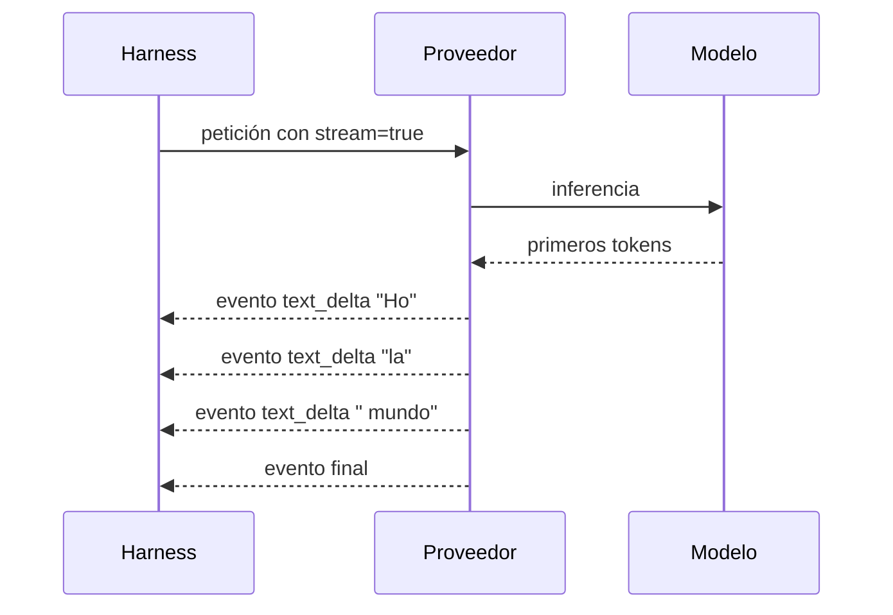

# 2. La frontera HTTP, JSON y streaming

## Objetivo del capítulo

En el capítulo anterior tratamos la petición al modelo como una caja:

```text
Harness → petición → proveedor/modelo → respuesta → Harness
```

Ahora abriremos esa caja. Al terminar deberías poder:

- distinguir API, HTTP, JSON y JSONL;
- leer una petición y una respuesta HTTP básicas;
- entender cómo se representan mensajes y tools como datos;
- explicar por qué el streaming produce deltas y no mensajes completos;
- separar errores de transporte, protocolo, proveedor, modelo y herramienta;
- reconocer qué normaliza un adaptador de proveedor.

No necesitas saber TypeScript. Los fragmentos TypeScript que aparezcan describen
formas de datos; los leeremos como contratos, no como programas que debas dominar.

## 1. Cuatro conceptos que suelen mezclarse

### API: el contrato

Una **API** define cómo puede un componente pedir operaciones a otro. Especifica, por
ejemplo:

- qué operaciones existen;
- qué datos acepta cada operación;
- qué devuelve;
- cómo comunica errores;
- cómo se autentica el cliente.

Una API no tiene que utilizar Internet. Una función de una librería, un socket Unix o
un proceso controlado mediante stdin/stdout también pueden exponer una API.

### HTTP: un protocolo de intercambio

**HTTP** es un protocolo de petición y respuesta. Un cliente envía una petición a un
servidor y el servidor devuelve una respuesta. Muchas APIs de modelos utilizan HTTPS,
que es HTTP protegido mediante TLS.

HTTP define elementos como método, URL, cabeceras, cuerpo y código de estado. No
define por sí mismo qué significa `messages`, `tools` o `model`.

### JSON: una representación de datos

**JSON** es una sintaxis textual para representar valores estructurados. Dispone de:

- objetos: `{"name": "read"}`;
- arrays: `["read", "bash"]`;
- strings: `"texto"`;
- números: `42`;
- booleanos: `true` y `false`;
- valor nulo: `null`.

JSON no es un protocolo de red, no ejecuta código y no llama a funciones. Puede viajar
en el cuerpo de HTTP, guardarse en un archivo o escribirse por stdout.

### JSONL: una secuencia de registros

**JSONL** —también llamado JSON Lines— coloca un valor JSON independiente en cada
línea:

```jsonl
{"type":"turn_start"}
{"type":"text_delta","delta":"Hola"}
{"type":"turn_end"}
```

El documento completo no es un único JSON válido. Son tres documentos JSON,
separados por saltos de línea. Esto permite consumir eventos conforme llegan sin esperar
al final del proceso.

## 2. Anatomía de HTTP

Una petición HTTP conceptual podría ser:

```http
POST /v1/responses HTTP/1.1
Host: proveedor.example
Authorization: Bearer <credencial>
Content-Type: application/json
Accept: text/event-stream

{"model":"modelo-x","input":"Explica este directorio","stream":true}
```

Sus piezas son:

| Pieza | Ejemplo | Finalidad |
|---|---|---|
| Método | `POST` | Tipo general de operación solicitada |
| Ruta | `/v1/responses` | Recurso u operación del servidor |
| Cabeceras | `Content-Type`, `Authorization` | Metadatos de la petición |
| Cuerpo | El objeto JSON | Datos específicos de la operación |

Una respuesta no transmitida por streaming podría ser:

```http
HTTP/1.1 200 OK
Content-Type: application/json

{"id":"resp_123","status":"completed","output":[...]}
```

El código HTTP informa del resultado de esa interacción con el servidor:

| Familia | Significado general | Ejemplos típicos |
|---|---|---|
| `2xx` | Petición aceptada o completada | `200 OK` |
| `4xx` | Problema atribuible a la petición o autorización | `400`, `401`, `403`, `429` |
| `5xx` | El servidor no pudo atender correctamente | `500`, `502`, `503` |

Estos códigos no describen necesariamente el éxito de la tarea del agente. Una API
puede devolver `200 OK` y dentro del JSON indicar que la generación terminó por límite
de tokens. HTTP funcionó; la operación de nivel superior no terminó como queríamos.

## 3. Del objeto en memoria a los bytes

El harness trabaja internamente con objetos y arrays. Para cruzar una frontera como
HTTP necesita convertirlos a bytes. Ese proceso se llama **serialización**:

```text
objeto en memoria
    ↓ JSON.stringify / serializador equivalente
texto JSON
    ↓ codificación UTF-8
bytes enviados por HTTP
```

En el servidor ocurre el proceso inverso, la **deserialización**:

```text
bytes recibidos → texto UTF-8 → valores JSON → estructuras internas
```

Esto explica varios tipos de fallo distintos:

- JSON mal formado: falta una comilla o una llave.
- JSON válido con forma incorrecta: `messages` es un número en vez de un array.
- Forma correcta con valor inválido: se solicita un modelo inexistente.
- Petición válida pero no autorizada: falta permiso para ese modelo.

### JSON no es un objeto TypeScript

Este objeto TypeScript no es JSON:

```typescript
{
  model: "modelo-x",       // comentario
  stream: true,
  optional: undefined,
}
```

En JSON, las claves requieren comillas dobles, no existen comentarios ni `undefined`,
y una coma final puede ser inválida:

```json
{
  "model": "modelo-x",
  "stream": true
}
```

## 4. Una petición de modelo simplificada

Cada proveedor tiene su protocolo real, pero podemos razonar con una representación
neutral:

```json
{
  "model": "modelo-x",
  "messages": [
    {
      "role": "system",
      "content": "Eres un asistente que inspecciona proyectos."
    },
    {
      "role": "user",
      "content": "¿Qué archivos hay en el directorio?"
    }
  ],
  "tools": [
    {
      "name": "list_directory",
      "description": "Lista las entradas de un directorio",
      "input_schema": {
        "type": "object",
        "properties": {
          "path": {"type": "string"}
        },
        "required": ["path"]
      }
    }
  ]
}
```

Observa que la definición de la tool es solamente **información enviada al modelo**.
No contiene la implementación que lee el directorio. La implementación permanece en el
harness o en un sistema conectado.

`input_schema` describe la forma permitida de los argumentos. Un esquema puede exigir
que `path` sea un string, pero no demuestra que el usuario tenga permiso para leer esa
ruta. Validación estructural y autorización son controles diferentes.

## 5. Dos clases de respuesta del modelo

### Respuesta directa

El modelo puede producir contenido para el usuario:

```json
{
  "role": "assistant",
  "content": [
    {"type": "text", "text": "Necesito inspeccionar el directorio."}
  ],
  "stop_reason": "stop"
}
```

### Solicitud de herramienta

También puede producir un bloque estructurado:

```json
{
  "role": "assistant",
  "content": [
    {
      "type": "toolCall",
      "id": "call_7",
      "name": "list_directory",
      "arguments": {"path": "."}
    }
  ],
  "stop_reason": "toolUse"
}
```

El harness utiliza `name` para localizar una implementación e `id` para correlacionar
la llamada con su resultado. Después de ejecutarla puede construir:

```json
{
  "role": "toolResult",
  "toolCallId": "call_7",
  "toolName": "list_directory",
  "content": [
    {"type": "text", "text": "README.md\ncurso\ninvestigacion"}
  ],
  "isError": false
}
```

Este resultado se incorpora al siguiente contexto. El modelo no recibe mágicamente el
estado del directorio; recibe una representación creada por el harness.

## 6. Qué significa hacer streaming

Esperar a que el modelo complete toda la respuesta produce una latencia percibida alta.
Con **streaming**, el servidor entrega fragmentos conforme están disponibles:

```text
H
ol
a
, mundo
```

Esos fragmentos o **deltas** no son cuatro respuestas. Son actualizaciones de una única
respuesta que aún se está construyendo.



Una tool call también puede llegar fragmentada. El harness no debe ejecutar argumentos
parciales:

```text
delta 1: {"path":"/pro
delta 2: yecto"}
final:   {"path":"/proyecto"}
```

El texto intermedio podría parecer parseable accidentalmente y después cambiar. La
ejecución debe esperar al evento que declara completa la llamada.

### Transporte del proveedor frente a eventos de PI

El proveedor puede usar Server-Sent Events, WebSocket u otro protocolo para transmitir
la inferencia. PI normaliza ese flujo y expone sus propios eventos.

Cuando ejecutamos:

```bash
pi --mode json "Explica este repositorio"
```

PI escribe JSONL por stdout. Esto no significa que el proveedor también haya usado
JSONL. Son dos fronteras diferentes:

```text
Proveedor ── protocolo del proveedor ──> PI ── JSONL de PI ──> consumidor local
```

Según PI 1.3.0, `message_update` contiene deltas; `message_end.message` es el mensaje
final autoritativo. Un consumidor puede mostrar deltas en directo, pero debe reemplazar
su reconstrucción por el mensaje final cuando llegue.

## 7. Eventos de PI: run, turn, mensaje y tool

Una ejecución sencilla en modo JSON produce una secuencia parecida a:

```text
session
agent_start
  turn_start
    message_start(user)
    message_end(user)
    message_start(assistant, pending)
    message_update(...delta...)
    message_end(assistant, final)
  turn_end
agent_end
agent_settled
```

Si la respuesta incluye una tool call, aparecen eventos adicionales:

```text
tool_execution_start
tool_execution_update   # opcional; progreso parcial
tool_execution_end
```

El `toolCallId` permite unir estos eventos aunque existan varias llamadas. No conviene
correlacionarlas por orden ni por nombre: dos llamadas simultáneas podrían usar la misma
tool con argumentos distintos.

PI distingue además:

- `agent_end`: terminó una ejecución del agente de bajo nivel;
- `agent_settled`: ya no quedan reintentos, recuperación, compaction ni mensajes
  encolados que PI vaya a procesar automáticamente.

Por tanto, observar `agent_end` no siempre significa que todo el run de nivel de sesión
haya quedado definitivamente inactivo.

## 8. Taxonomía de errores

Decir simplemente «falló la API» oculta el lugar real del problema:

| Capa | Ejemplo | ¿Llegó al modelo? |
|---|---|---|
| Resolución/red | DNS no resuelve, conexión rechazada | No |
| TLS | Certificado inválido, negociación fallida | No |
| HTTP | `401`, `429`, `503` | Normalmente no se completó inferencia |
| Formato | JSON mal formado o campos incompatibles | No o rechazado al inicio |
| Proveedor/modelo | Modelo no disponible, límite de contexto | Depende |
| Streaming | Conexión cortada después de varios deltas | Parcialmente |
| Harness | No puede normalizar o persistir la respuesta | Quizá sí |
| Tool | Timeout, permiso Unix, salida inválida | La inferencia anterior sí |
| Tarea | Todo funcionó técnicamente, pero el resultado es incorrecto | Sí |

Esta distinción determina si tiene sentido reintentar. Un `503` temporal puede admitir
reintento. Un `401` requiere corregir autenticación. Reintentar una tool con efectos
después de un timeout puede duplicar el efecto.

## 9. La función del adaptador de proveedor

Los proveedores no utilizan exactamente los mismos endpoints, campos, eventos, roles,
identificadores ni razones de parada. PI necesita una capa que traduzca entre:

```text
representación común de PI
          ↕
adaptador específico del proveedor
          ↕
protocolo real del proveedor
```

El adaptador puede encargarse de:

- construir la petición admitida por ese proveedor;
- añadir autenticación;
- convertir tools al esquema esperado;
- interpretar su streaming;
- preservar metadatos opacos necesarios para continuar;
- normalizar uso, costes y razones de parada;
- mapear errores sin borrar información útil.

Una API «compatible con OpenAI» puede implementar una forma parecida de petición sin
replicar todos los detalles de streaming, tool calling, razonamiento o errores. La
compatibilidad debe comprobarse por capacidad, no por etiqueta.

## 10. Seguridad de esta frontera

- Nunca guardes tokens o cabeceras `Authorization` en el repositorio.
- Los logs de depuración pueden contener prompts, archivos, tool arguments y respuestas.
- TLS protege datos en tránsito, no impide que el proveedor procese el contenido.
- JSON válido no es necesariamente seguro ni autorizado.
- Un resultado recibido por HTTP sigue siendo entrada no confiable.
- No ejecutes una tool call parcial procedente del streaming.
- Limita tamaños y consume stdout continuamente: una tubería llena puede bloquear al
  proceso productor.

## Laboratorio: observar HTTP y JSON localmente

Este laboratorio no utiliza PI, modelos ni credenciales. Abre dos terminales.

### Paso 1: iniciar un servidor local

En la primera terminal, dentro de cualquier directorio de prueba:

```bash
python3 -m http.server 8000 --bind 127.0.0.1
```

El servidor escucha solamente en la interfaz local.

### Paso 2: inspeccionar una respuesta

En la segunda terminal:

```bash
curl -i http://127.0.0.1:8000/
```

Identifica:

1. la línea de estado;
2. las cabeceras;
3. la línea vacía que termina las cabeceras;
4. el cuerpo HTML.

Prueba después una ruta inexistente:

```bash
curl -i http://127.0.0.1:8000/no-existe
```

Compara el código HTTP con el de la primera respuesta. En la primera terminal observa
el log que produjo cada petición.

### Paso 3: validar JSON

```bash
printf '%s\n' '{"tool":"read","args":{"path":"README.md"}}' | jq .
```

Provoca después un error eliminando las comillas de `tool`. La diferencia no es que el
segundo contenido sea peligroso: simplemente no cumple la gramática JSON.

### Paso 4: consumir JSONL

```bash
printf '%s\n' \
  '{"type":"tool_start","id":"call_1"}' \
  '{"type":"tool_end","id":"call_1","ok":true}' \
  | jq -c 'select(.type == "tool_end")'
```

`jq` procesa cada línea como un valor independiente. Observa cómo `id` permite asociar
el inicio y el final.

Detén el servidor con `Ctrl+C` cuando termines.

## Comprobación de comprensión

1. ¿Qué diferencia existe entre una API, HTTP y JSON?
2. ¿Por qué un `200 OK` no demuestra que la tarea del agente haya tenido éxito?
3. ¿Por qué el esquema JSON de una tool no constituye una política de autorización?
4. ¿Qué diferencia hay entre el streaming del proveedor y el JSONL que PI escribe?
5. ¿Por qué no se deben ejecutar los argumentos parciales de una tool call?
6. Si una tool produce un efecto y después vence el timeout, ¿qué sabemos y qué no
   sabemos?

## Soluciones comentadas y matices importantes

### 1. API, HTTP y JSON

Los tres conceptos operan en niveles distintos:

```text
API   = contrato: qué operaciones se pueden solicitar y con qué datos
HTTP  = protocolo: cómo se intercambian peticiones y respuestas
JSON  = representación: cómo se escriben ciertos datos estructurados
```

Una API de modelos puede especificar que existe una operación de inferencia con campos
como `model`, `messages` y `tools`. Esa operación puede exponerse mediante una petición
HTTP cuyo cuerpo sea JSON. No obstante, una API también puede ser una función local y
HTTP puede transportar HTML, imágenes o bytes en lugar de JSON.

Los códigos HTTP contienen tres **dígitos**. Describen el resultado de la interacción
HTTP, no necesariamente el resultado final de la tarea del agente.

### 2. Por qué `200 OK` no demuestra el éxito del agente

En un mismo run existen varios niveles de éxito:

```text
¿Funcionó el transporte HTTP?
¿El proveedor aceptó la petición?
¿Terminó la inferencia?
¿La respuesta era válida y completa?
¿Se ejecutaron correctamente las tools?
¿Se consiguió el objetivo en el mundo externo?
```

`200 OK` responde principalmente a las primeras capas. El proveedor podría devolver
una generación válida que terminó por límite de longitud, una respuesta incorrecta o
un texto que afirma haber hecho algo que nunca sucedió. No hace falta que exista un
error HTTP ni un campo `error` para que el objetivo permanezca incompleto.

### 3. Por qué el esquema de una tool no es una política

Un esquema responde:

> ¿Los argumentos tienen la forma y los tipos esperados?

Una política responde:

> Aunque sean estructuralmente válidos, ¿tenemos autoridad para ejecutar esta acción
> concreta con estos argumentos?

```json
{
  "name": "scan_host",
  "arguments": {"target": "servidor-ajeno.example"}
}
```

`target` puede ser un string perfectamente válido y, al mismo tiempo, estar fuera del
alcance autorizado. Igualmente, `{"command":"rm -rf /datos"}` puede cumplir el esquema
de una tool `bash` sin ser una acción permitida.

```text
Esquema  → valida la forma
Política → valida la autoridad
```

Ambas comprobaciones son necesarias y ninguna sustituye a la otra.

### 4. Streaming del proveedor frente a JSONL de PI

Son dos fronteras distintas:

```text
Modelo/proveedor
      │ streaming y protocolo específico del proveedor
      ▼
     PI
      │ eventos normalizados como JSONL por stdout
      ▼
Programa consumidor de PI
```

El proveedor puede usar HTTP con Server-Sent Events, WebSocket u otro mecanismo. Su
adaptador interpreta nombres, campos y deltas específicos. PI los transforma en eventos
comunes como `message_start`, `message_update` y `message_end`.

El streaming del proveedor es una entrada para PI. El JSONL de `pi --mode json` es una
salida pública de PI para otro proceso local. No tiene por qué existir una relación uno
a uno entre los eventos de ambas fronteras.

### 5. Por qué no se ejecutan argumentos parciales

Una tool call puede llegar como fragmentos de texto serializado:

```text
fragmento 1: {"path":"/home/usuario/pro
fragmento 2: yecto","recursive":false}
```

Hasta recibir el evento final, el JSON puede estar incompleto y pueden faltar campos
que cambien el significado o riesgo de la operación. El orden seguro es:

```text
recibir fragmentos
→ reconstruir la tool call completa
→ parsear JSON
→ validar esquema
→ normalizar argumentos
→ evaluar política
→ ejecutar
```

En PI, un evento como `toolcall_end` entrega la llamada completa. No debe confundirse
con un supuesto «argumento de tipo end».

### 6. Efecto seguido de timeout

Considera esta secuencia:

```text
1. El harness solicita enviar un correo.
2. El servidor envía el correo.
3. Se pierde o retrasa la confirmación.
4. Vence el timeout del harness.
```

El harness sabe que inició la ejecución y que no recibió una respuesta completa a
tiempo. No sabe si la acción no empezó, quedó parcial o terminó y solo se perdió la
confirmación. El estado correcto es un resultado **incierto**, no necesariamente un
fallo sin efectos.

Reintentar a ciegas podría repetir la acción. Para recuperarse puede ser necesario
consultar el estado externo, utilizar una clave de idempotencia, localizar el
identificador de la operación o solicitar revisión humana.

```text
ausencia de confirmación ≠ ausencia de efecto
```

## Fuentes primarias

- [Pi: Message Types](https://pi.dev/docs/latest/message-types)
- [Pi: JSON Event Stream](https://pi.dev/docs/latest/json)
- [MDN: Overview of HTTP](https://developer.mozilla.org/en-US/docs/Web/HTTP/Guides/Overview)
- [RFC 8259: The JavaScript Object Notation Data Interchange Format](https://www.rfc-editor.org/rfc/rfc8259)

## Siguiente capítulo

[Mensajes, tokens y contexto](03-mensajes-tokens-y-contexto.md)
