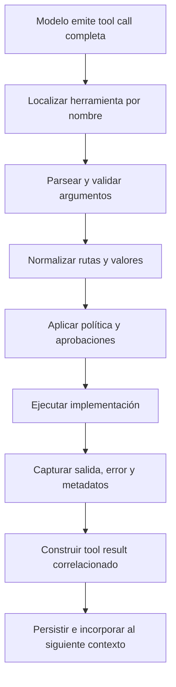

# 4. Tool calling

## Objetivo del capítulo

Una tool call no es una función que el modelo ejecuta. Es una propuesta estructurada
que cruza varias fronteras antes de producir, o no, un efecto real.

Al terminar deberías poder:

- separar declaración, solicitud, validación, autorización, ejecución y resultado;
- explicar para qué sirven el nombre, el esquema y el identificador de llamada;
- distinguir errores de argumentos, política, ejecución y observación;
- razonar sobre paralelismo, estado compartido y condiciones de carrera;
- entender timeouts, cancelación, reintentos e idempotencia;
- reconocer qué materializa PI y qué garantías no ofrece por sí mismo.

## 1. El contrato tiene dos caras

Una herramienta agente combina una cara visible para el modelo y una implementación
que permanece en el harness:

```text
declaración enviada al modelo       implementación ejecutable
┌─────────────────────────┐       ┌─────────────────────────┐
│ nombre                  │       │ código                   │
│ descripción             │       │ credenciales/permisos   │
│ esquema de argumentos   │       │ acceso al mundo externo │
│ pautas de uso           │       │ manejo de errores        │
└─────────────────────────┘       └─────────────────────────┘
           contexto                         proceso anfitrión
```

El modelo ve suficiente información para decidir si propone una llamada y con qué
argumentos. No recibe por ello el código de la implementación ni adquiere sus permisos.

Una definición simplificada podría ser:

```json
{
  "name": "read_file",
  "description": "Lee un archivo de texto del workspace",
  "input_schema": {
    "type": "object",
    "properties": {
      "path": {"type": "string"}
    },
    "required": ["path"],
    "additionalProperties": false
  }
}
```

La calidad del contrato influye en la elección del modelo. Una descripción ambigua o
un esquema demasiado permisivo aumentan llamadas equivocadas. Aun así, un contrato
perfecto no sustituye controles de seguridad en el ejecutor.

## 2. Una llamada completa atraviesa varias decisiones

El recorrido seguro no es «modelo llama función», sino:



Cada etapa responde una pregunta distinta:

| Etapa | Pregunta |
|---|---|
| Resolución | ¿Existe una tool activa con ese nombre? |
| Validación | ¿Los argumentos tienen la forma declarada? |
| Normalización | ¿Qué recurso concreto designan? |
| Autorización | ¿Se permite esta acción sobre ese recurso? |
| Ejecución | ¿Qué ocurrió al realizarla? |
| Representación | ¿Qué parte del resultado recibirá el modelo? |

Validar `{"path":"../../secretos"}` como un objeto que contiene un string no
autoriza esa ruta. Primero puede ser necesario resolverla a una ruta canónica y luego
comprobar si cae dentro del alcance permitido.

## 3. El identificador conserva causalidad

Una respuesta del asistente puede contener varias llamadas:

```json
[
  {"type":"toolCall", "id":"call_a", "name":"read", "arguments":{"path":"A.md"}},
  {"type":"toolCall", "id":"call_b", "name":"read", "arguments":{"path":"B.md"}}
]
```

Los resultados pueden terminar en otro orden. `toolCallId` evita asociarlos por
posición, nombre o tiempo:

```json
{"role":"toolResult", "toolCallId":"call_b", "toolName":"read", "isError":false}
{"role":"toolResult", "toolCallId":"call_a", "toolName":"read", "isError":false}
```

El identificador no demuestra que la ejecución fuera correcta. Solo permite afirmar
qué resultado corresponde a qué solicitud.

## 4. Streaming de una llamada no equivale a ejecución incremental

Durante el streaming, nombre y argumentos pueden llegar por fragmentos:

```text
toolcall_start  id=call_a name=read
toolcall_delta  {"path":"curso/01-funda
toolcall_delta  mentos/04-tool-calling.md"}
toolcall_end    llamada completa y autoritativa
```

Los deltas sirven para renderizar progreso. El dispatcher debe esperar la llamada
completa, parsearla y validarla antes de ejecutar. Un prefijo sintácticamente válido
podría recibir después campos que cambien su significado.

PI separa este streaming del ciclo de ejecución:

```text
toolcall_start/delta/end
             ↓
tool_execution_start/update/end
```

Los primeros eventos describen la generación de la solicitud; los segundos describen
el trabajo real de la herramienta.

## 5. El resultado es una representación, no el mundo

En PI un resultado contiene como mínimo contenido para el modelo y una marca de error;
puede incluir además detalles estructurados, uso de modelos anidados y metadatos:

```text
ToolResultMessage
├── toolCallId
├── toolName
├── content: texto o imágenes para el modelo
├── details: datos propios de la tool
├── isError
├── usage: trabajo de modelos anidados, si existe
└── nestedCalls: metadatos acotados de llamadas internas, si existen
```

Conviene distinguir cuatro hechos:

```text
solicitud  = lo que propuso el modelo
ejecución = el intento realizado por el harness
efecto     = lo que cambió u ocurrió fuera
resultado  = la observación devuelta al contexto
```

Pueden divergir. Un proceso puede escribir un archivo y fallar al construir la
respuesta. Una API puede aceptar un trabajo asíncrono sin haberlo completado. Una tool
mal implementada puede devolver `success` aunque el efecto no se produjera.

## 6. Fallar también produce información

No todos los fallos significan lo mismo:

| Clase | Ejemplo | ¿Hubo ejecución? | ¿Pudo haber efecto? |
|---|---|---:|---:|
| Resolución | Tool inexistente | No | No |
| Validación | Falta `path` | No | No |
| Política | Ruta denegada | No | No |
| Arranque | Ejecutable ausente | Intento | Normalmente no |
| Aplicación | Proceso sale con código 1 | Sí | Quizá |
| Timeout | No llegó confirmación | Sí o incierto | Quizá |
| Cancelación | Se solicitó abortar | Quizá | Quizá |

El resultado de error debe entrar en el contexto para que el modelo pueda diagnosticar,
cambiar de estrategia o pedir ayuda. Ocultarlo fuerza al modelo a adivinar.

En una custom tool de PI, lanzar una excepción produce un resultado fallido. Si el
fallo debe conservar datos estructurados, la tool puede devolverlos con `isError: true`.

## 7. Paralelismo y estado compartido

PI puede ejecutar en paralelo las tool calls de un mismo mensaje del asistente. Esto
reduce latencia cuando son independientes:

```text
leer A ───────┐
              ├── reunir resultados → siguiente inferencia
leer B ───┐   │
buscar C ─┴───┘
```

No es seguro cuando varias operaciones comparten estado mutable:

```text
call_a: leer contador=0 → escribir 1
call_b: leer contador=0 → escribir 1
resultado esperado: 2
resultado posible:  1
```

Por tanto:

- las operaciones independientes pueden paralelizarse;
- las dependencias deben expresarse en turns separados o mediante un orquestador;
- el estado mutable compartido necesita serialización, bloqueo o una operación atómica;
- leer-modificar-escribir debe protegerse como una unidad, no solo durante la escritura.

PI recomienda ejecución secuencial para tools con estado compartido y ofrece una cola
de mutaciones para que las tools de archivos protejan la operación completa.

## 8. Timeout, cancelación e incertidumbre

Un timeout limita cuánto espera el llamador. No rebobina automáticamente el mundo:

```text
harness        tool/servicio          mundo
   | iniciar         |                  |
   |---------------->| escribir dato    |
   |                 |----------------->|
   | vence timeout   |                  |
   |<------ error    | confirmación X  |
```

La cancelación es además cooperativa en muchos sistemas. Una señal expresa que el
resultado ya no se desea, pero la implementación o el servicio remoto deben observarla
y detenerse. Incluso entonces, los efectos anteriores a la detención permanecen.

Ante resultado incierto, las opciones responsables son consultar el estado externo,
buscar un identificador de operación, ejecutar una acción compensatoria o pedir
intervención. «No recibí confirmación» no significa «no ocurrió».

## 9. Reintentos e idempotencia

Una operación es idempotente cuando repetirla con la misma intención no acumula un
efecto adicional relevante:

```text
establecer_estado("cerrado")  → normalmente idempotente
incrementar_saldo(10)         → no idempotente
enviar_correo()               → no idempotente
```

Esto no se deduce del método HTTP ni del nombre de la tool. Debe formar parte del
contrato real. Algunas APIs aceptan una clave de idempotencia: repeticiones con la misma
clave recuperan la operación original en vez de crear otra.

Un reintento automático solo es seguro si conocemos:

1. qué capa falló;
2. si la primera ejecución pudo causar efectos;
3. si la operación es idempotente o tiene deduplicación;
4. cuántos intentos y qué espera exponencial se permiten.

Los reintentos de una inferencia del proveedor y los reintentos de una tool son
problemas distintos. Repetir la inferencia puede generar una tool call nueva; repetir
la tool puede duplicar el efecto de una llamada ya generada.

## 10. Salidas grandes y resultados estructurados

Devolver todo no siempre ayuda. Una salida enorme consume contexto, puede desplazar
evidencia relevante y encarecer cada inferencia posterior.

Una tool robusta puede:

- truncar la vista destinada al modelo;
- guardar el resultado completo en un archivo y devolver su ruta;
- paginar mediante cursor;
- filtrar o agregar cerca de la fuente;
- devolver datos estructurados a consumidores programáticos y un resumen al modelo.

En PI, `content` es lo que ve el modelo. Una tool con `outputSchema` puede devolver
además `structuredContent` para callers programáticos como scripts de codemode. No debe
suponerse que texto de presentación y contrato de datos son la misma interfaz.

## 11. Tools que llaman a tools

Una herramienta orquestadora puede invocar otras herramientas. PI permite hacerlo con
`ctx.executeTool()`: las llamadas anidadas vuelven a pasar por validación y handlers de
política, y emiten sus propios eventos.

No se añaden como mensajes independientes al transcript principal. La tool exterior
decide cómo representar su resultado, mientras PI conserva metadatos acotados de las
llamadas anidadas.

Codemode es un ejemplo: el modelo genera un programa JavaScript que puede llamar tools
en serie o en paralelo y filtrar resultados. El programa corre en un sandbox QuickJS,
pero las tools llamadas siguen produciendo efectos reales bajo sus propias fronteras.
Si el script falla, las llamadas ya realizadas no se deshacen.

## 12. Exposición, hints y autoridad en PI

PI 1.3.0 distingue varias formas de exponer tools. Una tool puede declararse
directamente al modelo, estar disponible solo desde otra tool, cargarse bajo demanda o
permanecer oculta.

Las anotaciones `readOnlyHint`, `destructiveHint`, `idempotentHint` y `openWorldHint`
describen intención. Son pistas no verificadas: una extensión de permisos puede usarlas
para decidir qué confirmar, pero la etiqueta por sí sola no restringe la implementación.

Antes de ejecutar, un handler `tool_call` puede modificar argumentos o bloquear la
llamada. Después, handlers `tool_result` pueden transformar el resultado. Las custom
tools y extensiones siguen ejecutándose con los permisos del proceso PI salvo que exista
una frontera externa de sistema operativo o virtualización.

```text
descripción de seguridad en contexto ≠ control aplicado
hint declarativo                   ≠ garantía verificada
directorio de trabajo             ≠ sandbox
```

## 13. Dispatcher mínimo

Este pseudocódigo muestra las responsabilidades esenciales:

```typescript
async function dispatch(call, signal) {
  const tool = activeTools.get(call.name);
  if (!tool) return errorResult(call, "unknown tool");

  const parsed = tool.schema.safeParse(call.arguments);
  if (!parsed.success) return errorResult(call, "invalid arguments");

  const normalized = normalize(parsed.data);
  const decision = await policy.authorize(tool, normalized);
  if (!decision.allowed) return errorResult(call, decision.reason);

  try {
    const output = await tool.execute(normalized, { signal });
    return successResult(call, limitForContext(output));
  } catch (error) {
    return errorResult(call, describe(error));
  }
}
```

En producción faltan decisiones sobre logging, secretos, actualizaciones parciales,
timeouts, concurrencia, resultados inciertos y persistencia. El valor del esquema es
mostrar que esas responsabilidades pertenecen al harness, no al modelo.

## Laboratorio: observar una tool call real en PI

Este laboratorio realiza una inferencia y puede consumir cuota del proveedor. Limita
PI a una tool de solo lectura y guarda el stream fuera del repositorio:

```bash
pi --mode json --tools read \
  "Lee README.md con la herramienta read y dime solamente su título" \
  > /tmp/pi-tool-call.jsonl
```

### Paso 1: observar la solicitud generada

```bash
jq -c '
  select(.type == "message_update")
  | .assistantMessageEvent
  | select(.type | startswith("toolcall"))
' /tmp/pi-tool-call.jsonl
```

Busca `toolcall_start`, posibles deltas y `toolcall_end`. La llamada completa del final
es la que debe validarse y ejecutarse.

### Paso 2: observar la ejecución

```bash
jq -c '
  select(.type | startswith("tool_execution"))
  | {type, toolCallId, toolName, isError, durationMs}
' /tmp/pi-tool-call.jsonl
```

Comprueba que el mismo `toolCallId` correlaciona inicio y final. `durationMs` puede
aparecer solo cuando la implementación llegó a ejecutarse.

### Paso 3: observar turns y continuación

```bash
jq -c '
  select(.type == "turn_end")
  | {stopReason: .message.stopReason, toolResults: (.toolResults | length)}
' /tmp/pi-tool-call.jsonl
```

Normalmente verás un turn que solicita `read` y otro que utiliza el resultado para
responder. El comportamiento exacto lo decide el modelo; el prompt no garantiza que
escoja la tool.

### Paso 4: correlacionar resultados aunque cambie el orden

Este ejercicio no usa modelo:

```bash
printf '%s\n' \
  '{"type":"tool_execution_end","toolCallId":"call_b","result":"B"}' \
  '{"type":"tool_execution_end","toolCallId":"call_a","result":"A"}' \
  | jq -s 'sort_by(.toolCallId) | map({id: .toolCallId, result})'
```

La identidad, no el orden de llegada, conserva la relación causal.

## Comprobación de comprensión

1. ¿Qué diferencia hay entre la declaración de una tool y su implementación?
2. ¿Por qué validar un esquema no autoriza la acción?
3. ¿Por qué se necesita `toolCallId` si varias llamadas usan la misma tool?
4. ¿Qué diferencia existe entre `toolcall_end` y `tool_execution_end`?
5. ¿Cuándo es peligroso ejecutar llamadas en paralelo?
6. Si una tool vence por timeout, ¿por qué no debemos asumir que no hubo efecto?
7. ¿Qué propiedad hace más seguro un reintento y qué no garantiza por sí sola?
8. ¿Por qué una anotación `readOnlyHint` no es una frontera de seguridad?

## Fuentes primarias

- [Pi: How Pi Works](https://pi.dev/docs/latest/how-pi-works)
- [Pi: Extensions](https://pi.dev/docs/latest/extensions)
- [Pi: Message Types](https://pi.dev/docs/latest/message-types)
- [Pi: JSON Event Stream](https://pi.dev/docs/latest/json)
- [Pi: Command Line — Tools](https://pi.dev/docs/latest/cli#tools)
- [Pi: Codemode](https://pi.dev/docs/latest/codemode)
- [Pi: Security](https://pi.dev/docs/latest/security)

## Siguiente capítulo

[Estado, sesiones y compaction](05-estado-sesiones-y-compaction.md)
